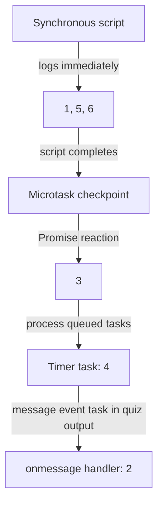

# 📝 [60. postMessage](https://bigfrontend.dev/quiz/postMessage)

## 📌 Problem Overview

Determine the order in which the log statements run when synchronous code, a Promise reaction, a timer, and a `message` event are scheduled.

```javascript
console.log(1)

window.onmessage = () => {
  console.log(2)
}

Promise.resolve().then(() => {
  console.log(3)
})

setTimeout(() => {
  console.log(4)
}, 0)

console.log(5)

window.postMessage('')

console.log(6)
```

---

## 🚀 Correct Answer
>
> [!TIP]
> **Output:**
>
> ```text
> 1
> 5
> 6
> 3
> 4
> 2
> ```

---

## 🔍 Detailed Explanation & Spec-Accurate Trace

JavaScript runs the current script to completion before processing queued asynchronous work. Promise reactions are processed as microtasks after the current synchronous task. The timer callback and the `message` event callback are tasks; neither is a Promise microtask.

### ⚡ Key Spec Rules / Concepts

1. **Run-to-completion**: The browser does not interrupt this script to run a timer or event handler. The three synchronous logs therefore happen before either callback.
2. **Promise reactions are microtasks**: Calling `.then()` on an already-fulfilled Promise queues its reaction job. It runs at the microtask checkpoint after the current script.
3. **Timers and posted messages are tasks**: `setTimeout` schedules a timer task, while `window.postMessage` schedules delivery of a `message` event. Posting the message does not synchronously invoke `onmessage`, and it does not put the handler in the Promise microtask queue.
4. **Task-source ordering has limits**: The HTML event loop processes tasks from task queues, but ordering between different task sources is not a portable scheduling guarantee. The sequence below is the quiz's expected browser output; application logic should not depend on a timer and a posted-message task always having this relative order.

---

### Step-by-Step Execution

#### 1. `console.log(1)` -> `1`

- **Step A**: The script starts executing synchronously.
- **Step B**: The first `console.log` runs immediately.
- **Output**: `1`

#### 2. `window.onmessage = ...` -> handler registered

- **Step A**: The function is assigned as the window's `message` event handler.
- **Step B**: Registering the handler does not invoke it or log anything.
- **Output**: No output

#### 3. `Promise.resolve().then(() => console.log(3))` -> reaction queued

- **Step A**: `Promise.resolve()` returns an already-fulfilled Promise.
- **Step B**: `.then()` queues its reaction as a microtask; the callback waits until the current script finishes.
- **Output**: No output yet

#### 4. `setTimeout(() => console.log(4), 0)` -> timer task scheduled

- **Step A**: The browser schedules the callback as timer work; a delay of `0` does not make it synchronous.
- **Step B**: The callback cannot run until the current script yields.
- **Output**: No output yet

#### 5. `console.log(5)` -> `5`

- **Step A**: The current script continues synchronously.
- **Step B**: The fifth value is logged before any queued callback runs.
- **Output**: `5`

#### 6. `window.postMessage('')` -> message event scheduled

- **Step A**: The browser posts a message to the same window.
- **Step B**: The `message` event handler is scheduled for later task processing; `postMessage` does not call it inline.
- **Output**: No output yet

#### 7. `console.log(6)` -> `6`

- **Step A**: The synchronous script continues after `postMessage`.
- **Step B**: It logs `6` before the event loop processes queued asynchronous callbacks.
- **Output**: `6`

#### 8. Promise reaction -> `3`

- **Step A**: The script finishes, so the event loop performs a microtask checkpoint.
- **Step B**: The queued Promise reaction runs before the browser proceeds to another task.
- **Output**: `3`

#### 9. Timer and message callbacks -> `4`, then `2` in the quiz output

- **Step A**: The browser processes queued tasks after the microtask checkpoint.
- **Step B**: In the expected output for this quiz, the timer callback logs `4` before delivery of the posted `message` invokes `onmessage` and logs `2`.
- **Output**: `4`, then `2`

---

## 💡 Key Takeaway

* **Promise callbacks are microtasks**: A `.then()` reaction runs after the current synchronous script and before the next task.
* **`postMessage` is asynchronous task delivery**: The receiving `message` handler is not a microtask and is not called directly by `postMessage`.
* **Do not infer a universal order across task sources**: The shown `4`-before-`2` result is the quiz's expected output, but robust code should not rely on a fixed ordering between unrelated timer and message tasks.

---

## 🛠️ Recommendations & Best Practices

* **Choose the scheduling mechanism deliberately**: Use Promise reactions or `queueMicrotask` for microtask sequencing; use timers and message events only when task-based asynchronous delivery is appropriate.
* **Validate incoming messages**: For cross-window messaging, check `event.origin`, `event.source`, and the shape of `event.data` before acting on it.

```javascript
const expectedOrigin = 'https://example.com'

window.addEventListener('message', (event) => {
  if (event.origin !== expectedOrigin) return
  if (typeof event.data !== 'string') return

  handleMessage(event.data)
})
```

---

## 🧠 Revision Tips & Cheat Sheet

### Visual Coercion Path / Logical Flow



---

## 🔗 Helpful Resources

- [ECMA-262 Specification - Jobs and Job Queues](https://tc39.es/ecma262/#sec-jobs-and-job-queues)
- [HTML Standard - Event loops](https://html.spec.whatwg.org/multipage/webappapis.html#event-loops)
- [HTML Standard - Posting messages](https://html.spec.whatwg.org/multipage/web-messaging.html#posting-messages)
- [MDN Web Docs - `Window.postMessage()`](https://developer.mozilla.org/en-US/docs/Web/API/Window/postMessage)
- [MDN Web Docs - `setTimeout()`](https://developer.mozilla.org/en-US/docs/Web/API/Window/setTimeout)
- [BFE.dev - Quiz 60](https://bigfrontend.dev/quiz/postMessage)

---

## 🏷️ Tags

`#JavaScript` `#EventLoop` `#Microtasks` `#postMessage` `#SpecDeepDive`
