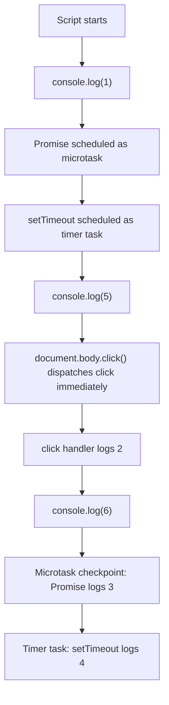

# 📝 [61. onClick](https://bigfrontend.dev/quiz/onClick)

## 📌 Problem Overview

Determine the order of logs when a click listener is registered, a Promise resolves, a timer is queued, and the element is clicked programmatically.

```javascript
console.log(1)

document.body.addEventListener('click', () => {
  console.log(2)
})

Promise.resolve().then(() => {
  console.log(3)
})

setTimeout(() => {
  console.log(4)
}, 0)

console.log(5)

document.body.click()

console.log(6)
```

---

## 🚀 Correct Answer
>
> [!TIP]
> **Output:**
>
> ```text
> 1
> 5
> 2
> 6
> 3
> 4
> ```

---

## 🔍 Detailed Explanation & Spec-Accurate Trace

JavaScript executes the current script synchronously before the browser drains queued async work. The important distinction here is that calling `document.body.click()` dispatches a DOM `click` event immediately in the same task; it does not wait until the event loop reaches the next turn. Promise reactions run as microtasks after the current task completes, and the timer callback runs as a later macrotask.

### ⚡ Key Spec Rules / Concepts

1. **Run-to-completion for the current task**: The script runs from top to bottom without interruption, so the initial synchronous `console.log` statements execute in order.
2. **Synchronous event dispatch**: Calling `HTMLElement.click()` triggers the click event immediately, so the registered listener runs before the function returns.
3. **Promise reactions are microtasks**: `Promise.resolve().then(...)` queues a microtask to run after the current task drains.
4. **Timers are macrotasks**: `setTimeout(..., 0)` schedules a future task, which runs after microtasks are processed.

---

### Step-by-Step Execution

#### 1. `console.log(1)` -> `1`

- **Step A**: The script begins executing synchronously.
- **Step B**: The first `console.log` prints immediately.
- **Output**: `1`

#### 2. `document.body.addEventListener('click', ...)` -> handler registered

- **Step A**: A `click` listener is attached to the body element.
- **Step B**: No log happens at registration time; the callback waits for the event.
- **Output**: No output

#### 3. `Promise.resolve().then(() => console.log(3))` -> microtask queued

- **Step A**: `Promise.resolve()` creates an already-fulfilled Promise.
- **Step B**: `.then()` queues a microtask reaction for later execution.
- **Output**: No output yet

#### 4. `setTimeout(() => console.log(4), 0)` -> timer task scheduled

- **Step A**: The timer callback is queued as a future task.
- **Step B**: It cannot run before the current script yields control to the event loop.
- **Output**: No output yet

#### 5. `console.log(5)` -> `5`

- **Step A**: Execution continues synchronously.
- **Step B**: The second log runs immediately.
- **Output**: `5`

#### 6. `document.body.click()` -> event callback runs immediately

- **Step A**: The browser dispatches the synthetic click event synchronously.
- **Step B**: The registered listener executes right away and logs `2` before `click()` returns.
- **Output**: `2`

#### 7. `console.log(6)` -> `6`

- **Step A**: The original script resumes after the event dispatch completes.
- **Step B**: The final synchronous log prints.
- **Output**: `6`

#### 8. Microtask checkpoint -> `3`

- **Step A**: The current task is complete, so the microtask queue is drained.
- **Step B**: The Promise reaction runs next and logs `3`.
- **Output**: `3`

#### 9. Timer task -> `4`

- **Step A**: After microtasks finish, the event loop moves to the timer task queue.
- **Step B**: The `setTimeout` callback runs and logs `4`.
- **Output**: `4`

---

## 💡 Key Takeaway

* **`click()` is synchronous for event delivery**: Unlike timers or Promise callbacks, the click listener is invoked immediately when the method fires.
* **Microtasks run after the current task, not before**: The Promise callback is delayed until after the script and the click event handler finish.
* **Timers are deferred to a later task**: `setTimeout(..., 0)` happens after microtasks are drained, which is why it logs after `3`.

---

## 🛠️ Recommendations & Best Practices

* **Use explicit event flow for DOM interactions**: If a side effect must happen after the current task settles, schedule it with `queueMicrotask` or a Promise rather than relying on event timing.
* **Avoid mixing UI event order assumptions with async scheduling**: Code that depends on the relative ordering of DOM events, timers, and microtasks should be written deliberately and tested.

```javascript
const button = document.querySelector('button')

button.addEventListener('click', () => {
  Promise.resolve().then(() => {
    console.log('UI event handled, then microtask runs')
  })
})
```

---

## 🧠 Revision Tips & Cheat Sheet

### Visual Event Loop Flow



---

## 🔗 Helpful Resources

- [ECMA-262 Specification - Jobs and Job Queues](https://tc39.es/ecma262/#sec-jobs-and-job-queues)
- [MDN Web Docs - `HTMLElement.click()`](https://developer.mozilla.org/en-US/docs/Web/API/HTMLElement/click)
- [MDN Web Docs - `EventTarget.addEventListener()`](https://developer.mozilla.org/en-US/docs/Web/API/EventTarget/addEventListener)
- [MDN Web Docs - `setTimeout()`](https://developer.mozilla.org/en-US/docs/Web/API/Window/setTimeout)
- [BFE.dev - Quiz 61](https://bigfrontend.dev/quiz/onClick)

---

## 🏷️ Tags

`#JavaScript` `#DOM` `#EventLoop` `#Microtasks` `#SpecDeepDive`