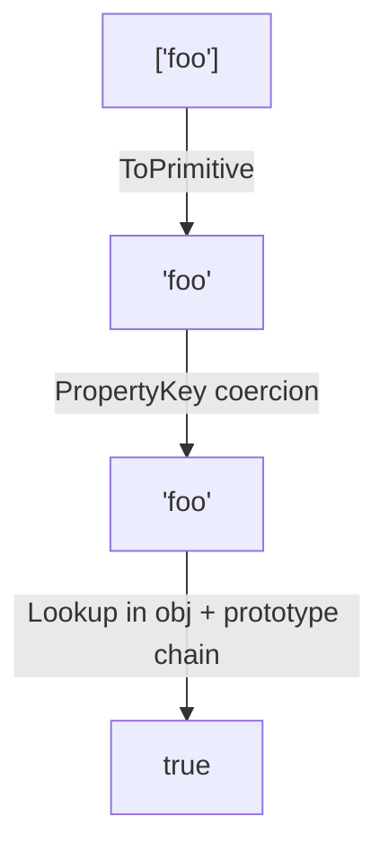

# 📝 [63. in](https://bigfrontend.dev/quiz/in-coercion)

## 📌 Problem Overview

```javascript
const obj = {
  foo: 'bar'
}

console.log('foo' in obj)
console.log(['foo'] in obj)

// true
// true
```

---

## 🚀 Correct Answer
>
> [!TIP]
> **Output:**
>
> ```text
> true
> true
> ```

---

## 🔍 Detailed Explanation & Spec-Accurate Trace

The `in` operator checks whether a property exists on an object or anywhere in its prototype chain. The key point is that the left-hand operand is converted to a property key before lookup, and non-symbol values are coerced to strings.

### ⚡ Key Spec Rules / Concepts

1. **Rule 1 (Property key coercion)**: The `in` operator first converts its left operand to a `PropertyKey` using the same general coercion logic as object property access. Strings are kept as-is, while other values are converted to strings through `ToPrimitive`/`ToString`.
2. **Rule 2 (Prototype-chain lookup)**: `in` does not only check own properties. It also traverses the prototype chain until it finds the property or reaches `null`.
3. **Rule 3 (Array-to-string coercion)**: An array like `['foo']` is coerced to its primitive form, which is the string `"foo"`, so it behaves the same as the string `'foo'` in this case.

---

### Step-by-Step Execution

#### 1. `'foo' in obj` -> `true`

- **Step A**: The left-hand operand is the string `'foo'`, which is already a valid `PropertyKey`.
- **Step B**: The engine checks whether `obj` has a property named `'foo'` on itself or in its prototype chain.
- **Output**: `true`

#### 2. `['foo'] in obj` -> `true`

- **Step A**: The left-hand operand is an array object. Before property lookup, JavaScript converts the value to a property key.
- **Step B**: The array is coerced to a primitive value by calling `ToPrimitive`. For an array with one element, the default conversion uses `toString()`, so `['foo']` becomes `'foo'`.
- **Step C**: The engine now checks for property `'foo'` in `obj` and its prototype chain.
- **Output**: `true`

---

## 💡 Key Takeaway

* **Property names are coerced before `in` checks them**: A non-symbol left operand is converted to a string property key, so `['foo']` effectively becomes `'foo'`.
* **`in` checks more than own properties**: Even if a property is inherited, the operator returns `true`.

---

## 🛠️ Recommendations & Best Practices

* **Prefer explicit property checks when intent is clear**: If you want to know whether an object owns a property, use `Object.hasOwn()` instead of `in` when appropriate.
* **Be careful with coercion**: Since array-like values can become strings, avoid relying on implicit conversion if the intent is not clearly property-name lookup.

```javascript
const obj = { foo: 'bar' };

console.log(Object.hasOwn(obj, 'foo')); // true
console.log('foo' in obj); // true
console.log(['foo'] in obj); // true
```

---

## 🧠 Revision Tips & Cheat Sheet

### Visual Coercion Path / Logical Flow



---

## 🔗 Helpful Resources

- [ECMA-262 Specification - Property Accessors](https://tc39.es/ecma262/#sec-property-accessors)
- [MDN Web Docs - `in` operator](https://developer.mozilla.org/en-US/docs/Web/JavaScript/Reference/Operators/in)
- [BFE.dev - Quiz 63](https://bigfrontend.dev/quiz/in-coercion)

---

## 🏷️ Tags

`#inOperator` `#PropertyLookup` `#TypeCoercion` `#SpecDeepDive`