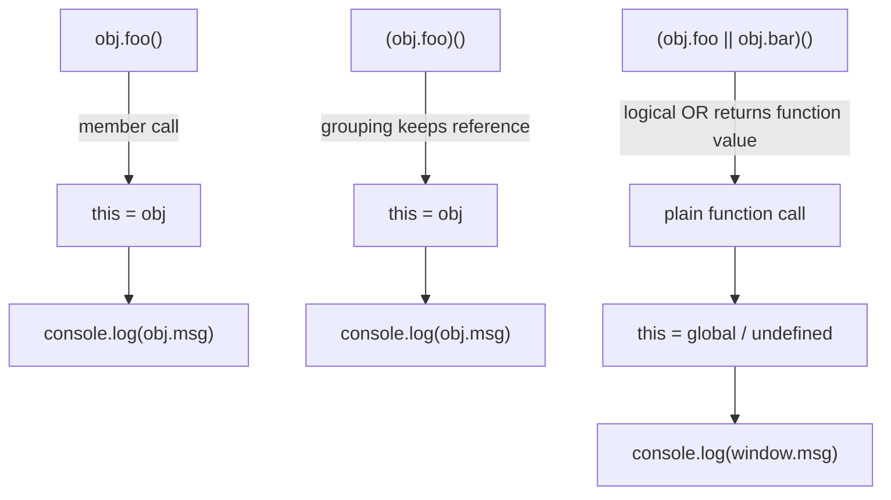

# 📝 [64. reference type](https://bigfrontend.dev/quiz/reference-type)

## 📌 Problem Overview

```javascript
const obj = {
  msg: 'BFE',
  foo() {
    console.log(this.msg)
  },
  bar() {
    console.log('dev')
  }
}

obj.foo();
(obj.foo)();
(obj.foo || obj.bar)();
```

---

## 🚀 Correct Answer
>
> [!TIP]
> **Output:**
>
> ```text
> "BFE"
> "BFE"
> undefined
> ```

---

## 🔍 Detailed Explanation & Spec-Accurate Trace

This quiz tests one of the most important rules in JavaScript: `this` is determined by how a function is called, not where it is defined. The key is understanding the difference between a property reference and a plain function value.

### ⚡ Key Spec Rules / Concepts

1. **Rule 1 (Reference Type / Property Call)**: When a function is called as a property access like `obj.foo()`, the engine creates a Reference Record and sets `this` to the base object (`obj`).
2. **Rule 2 (Grouping Operator)**: `(obj.foo)` is still the same property reference, so calling it as `(obj.foo)()` also binds `this` to `obj`.
3. **Rule 3 (Logical OR returns a value, not a reference)**: In `(obj.foo || obj.bar)()`, the `||` operator evaluates to the first truthy operand, which is `obj.foo`. That value is a plain function object, not a property reference to `obj.foo`, so the call loses the method-binding relationship.
4. **Rule 4 (Function call without a receiver)**: When a function is invoked as a standalone call, `this` is `undefined` in strict mode or the global object in non-strict mode. In a browser, that is `window`, so `this.msg` becomes `window.msg` and returns `undefined`.

---

### Step-by-Step Execution

#### 1. `obj.foo()` -> `"BFE"`

- **Step A**: `obj.foo` is a member access expression. The engine treats it as a Reference Record with base `obj` and property name `"foo"`.
- **Step B**: Because the call is in the form `obj.foo()`, the call expression invokes the function with `this` bound to `obj`.
- **Output**: `this.msg` resolves to `obj.msg`, which is `'BFE'`.

#### 2. `(obj.foo)()` -> `"BFE"`

- **Step A**: The grouping operator `()` does not destroy the property reference. `(obj.foo)` still resolves to the same function value, and the engine still sees it as a member reference.
- **Step B**: The call is effectively a method call on `obj`, so `this` is again `obj`.
- **Output**: `this.msg` is `obj.msg`, which is `'BFE'`.

#### 3. `(obj.foo || obj.bar)()` -> `undefined`

- **Step A**: The expression `obj.foo || obj.bar` is evaluated left-to-right. `obj.foo` is truthy, so the logical OR returns that function object.
- **Step B**: At this point, the result is just a function value. It is no longer a property reference tied to `obj`.
- **Step C**: Calling `(obj.foo || obj.bar)()` executes the function as a plain function call, not as `obj.foo()`. Therefore, `this` is not `obj`.
- **Output**: In non-strict mode, `this` becomes the global object (`window` in browsers), so `this.msg` is `window.msg`, which is `undefined`.

---

## 💡 Key Takeaway

* **Method binding depends on the call site**: `obj.foo()` and `(obj.foo)()` preserve the receiver because they are still property references.
* **The `||` operator strips away the receiver**: Once the expression returns the function value, the method binding is lost, and `this` is no longer `obj`.

---

## 🛠️ Recommendations & Best Practices

* **Prefer explicit receiver binding when passing methods around**: If you need a stable `this`, capture the object or bind the function explicitly.
* **Avoid relying on implicit `this` in callback-style usage**: Use arrow functions or explicit binding for predictable behavior.

```javascript
const obj = {
  msg: 'BFE',
  foo() {
    console.log(this.msg)
  }
}

const fn = obj.foo.bind(obj)
fn() // "BFE"
```

---

## 🧠 Revision Tips & Cheat Sheet

### Visual Coercion Path / Logical Flow



---

## 🔗 Helpful Resources

- [ECMA-262 Specification - Reference Record and `this` binding](https://tc39.es/ecma262/#sec-reference-record-specification-type)
- [MDN Web Docs - `this`](https://developer.mozilla.org/en-US/docs/Web/JavaScript/Reference/Operators/this)
- [MDN Web Docs - Logical OR `||`](https://developer.mozilla.org/en-US/docs/Web/JavaScript/Reference/Operators/Logical_OR)
- [BFE.dev - Quiz 64](https://bigfrontend.dev/quiz/reference-type)

---

## 🏷️ Tags

`#referenceType` `#thisBinding` `#methodCall` `#JavaScript` `#SpecDeepDive`
