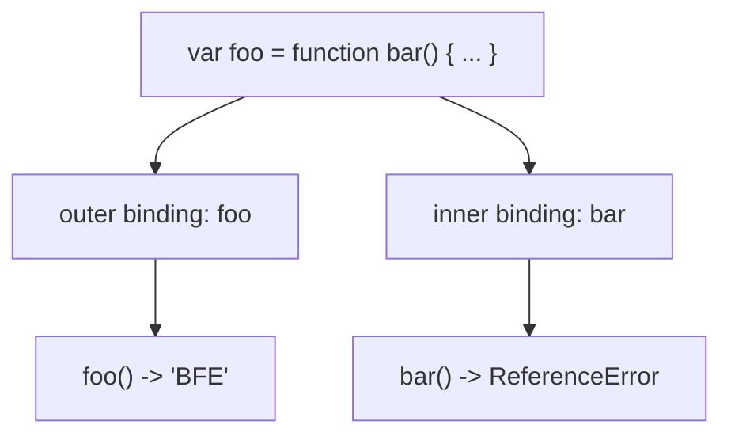

# 📝 [65. Function name](https://bigfrontend.dev/quiz/function-name)

## 📌 Problem Overview

This quiz tests how a named function expression creates an internal binding for its own name without exposing that name to the surrounding scope.

```javascript
var foo = function bar(){ 
  return 'BFE'; 
};

console.log(foo());
console.log(bar());
```

---

## 🚀 Correct Answer
>
> [!TIP]
> **Output:**
>
> ```text
> BFE
> ReferenceError: bar is not defined
> ```

---

## 🔍 Detailed Explanation & Spec-Accurate Trace

This quiz is about the scoping behavior of a named function expression. When a function is created using a function expression like `function bar() {}`, the identifier `bar` is bound inside the function expression’s own scope, not in the outer lexical environment that contains the assignment.

### ⚡ Key Spec Rules / Concepts

1. **Rule 1 (Named Function Expression Scope)**: In a function expression such as `function bar() {}`, the name `bar` is created as an internal binding of the function expression itself.
2. **Rule 2 (Outer Scope Is Not Polluted)**: That binding is not added to the surrounding scope where the function expression is assigned to `foo`.
3. **Rule 3 (Identifier Resolution)**: `foo()` resolves to the outer variable `foo`, but `bar()` must resolve in the outer environment, where no binding named `bar` exists, so it throws a `ReferenceError`.

---

### Step-by-Step Execution

#### 1. `foo()` -> `"BFE"`

- **Step A**: `foo` is assigned the function object produced by the named function expression `function bar() { return 'BFE'; }`.
- **Step B**: Calling `foo()` enters that function body and executes `return 'BFE'`.
- **Output**: `"BFE"`

#### 2. `bar()` -> `ReferenceError: bar is not defined`

- **Step A**: The identifier `bar` is resolved in the surrounding lexical environment, not inside the function body itself.
- **Step B**: There is no binding named `bar` in the outer scope. The internal name created for the function expression is local to that expression only.
- **Step C**: The JavaScript engine throws a `ReferenceError` because `bar` is not defined in the current scope chain.
- **Output**: `ReferenceError: bar is not defined`

---

## 💡 Key Takeaway

* **Named function expressions create an inner binding**: The name exists only within the function expression’s own scope, not in the surrounding environment.
* **The outer variable and the inner function name are different bindings**: `foo` is the external reference, while `bar` is only available inside the function expression.

---

## 🛠️ Recommendations & Best Practices

* **Use a clear outer variable name when assigning function expressions**: Prefer `const foo = function () {}` or `function foo() {}` when you want an external callable name.
* **Use named function expressions intentionally for recursion or readability**: If you need self-reference, keep the name inside the function expression and call it via the local binding.

```javascript
const foo = function bar() {
  console.log('Inside bar')
  return 'BFE'
}

console.log(foo()) // "BFE"
```

---

## 🧠 Revision Tips & Cheat Sheet

### Function Name Scope Flow



---

## 🔗 Helpful Resources

- [ECMA-262 Specification - Function Expressions](https://tc39.es/ecma262/#sec-function-definitions)
- [MDN Web Docs - Named function expressions](https://developer.mozilla.org/en-US/docs/Web/JavaScript/Reference/Operators/function)
- [BFE.dev - Quiz 65](https://bigfrontend.dev/quiz/function-name)

---

## 🏷️ Tags

`#FunctionExpression` `#Scope` `#FunctionName` `#JavaScript` `#SpecDeepDive`